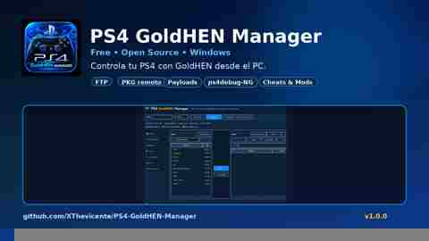

<p align="center">
  
</p>

<p align="center">
  <a href="https://github.com/XThevicente/PS4-GoldHEN-Manager/releases/latest"></a>
  <a href="https://github.com/XThevicente/PS4-GoldHEN-Manager/releases"></a>
  <a href="LICENSE"></a>
  
</p>

# PS4 GoldHEN Manager

**PS4 GoldHEN Manager** is a free and open-source Windows companion app for PS4 consoles running GoldHEN.

The goal is simple: bring the most useful PC-side GoldHEN workflows into one clean interface instead of juggling several separate tools.

## Download

### Windows

**[Download the latest release](https://github.com/XThevicente/PS4-GoldHEN-Manager/releases/latest)**

Current public release: **v1.0.0**

Direct v1.0.0 EXE:
[PS4_GoldHEN_Manager_v1.0.0.exe](https://github.com/XThevicente/PS4-GoldHEN-Manager/releases/download/v1.0.0/PS4_GoldHEN_Manager_v1.0.0.exe)

No Python installation is required when using the compiled Windows release.

## Beta 1.1.0 — Scene Hub (en pruebas)

Hay una **nueva beta para Windows** con una pestaña `📰 Scene Hub` que muestra noticias PS4/PS5 del portal, acceso al foro y versiones oficiales de GitHub. La lectura de noticias admite caché sin conexión y las consultas se ejecutan en segundo plano.

**[Descargar la beta desde GitHub Actions](https://github.com/XThevicente/PS4-GoldHEN-Manager/actions/workflows/build-windows.yml)** — abre la ejecución más reciente de `main` y descarga el artefacto `PS4_GoldHEN_Manager_v1.1.0-beta.2_Windows`. GitHub puede requerir iniciar sesión.

La **beta.2** separa la detección de la PS4 de la sesión FTP. Si Payload, Klog, Debug o RPI responden con FTP desactivado, muestra la consola y sus servicios disponibles. Para transferir archivos, activa FTP en GoldHEN y pulsa **Reintentar FTP**. Se conserva el puerto FTP configurado. [Estados de conexión y prueba en consola](docs/CONNECTION.md).

La release pública **v1.0.0 sigue siendo la estable**. La beta no descarga ni instala actualizaciones automáticamente y debe probarse antes de reemplazar la versión que utilizas habitualmente.

Documentación: [Scene Hub y pruebas](docs/SCENE_HUB.md)

Portal: https://itrsr62yvx.zite.so

## Beta 1.1.0-beta.4 — Transferencias y perfiles de consola (rama experimental)

Hay una nueva rama de pruebas con una cola FIFO para FTP PS4, estados de
transferencia, cancelación de tareas pendientes y un selector de consola.
El perfil de PS5 es **únicamente una vista previa sin conexión real**; los
servicios y protocolos PS4 se mantienen aislados.

**[Ver la rama experimental](https://github.com/XThevicente/PS4-GoldHEN-Manager/tree/feature/multiconsole-transfer-queue)**
y su [guía de pruebas](docs/MULTICONSOLE_BETA.md).

La versión estable `v1.0.0` permanece sin cambios. No hay reanudación
automática de transferencias, soporte PS5 funcional ni copia de código GPL-3.0
de PS5Upload.

## Beta 1.1.0-beta.6 — OrbisNet Online (rama de pruebas)

Incorpora una pestaña **OrbisNet · Online** independiente, con buscador de ejemplos de
juegos, enlaces controlados a la web, Discord y al anuncio del desarrollador.
Se integra con las anteriores funcionalidades experimentales de cola FTP y PS5
en vista previa. OrbisNet es una beta externa y no se instala, descarga ni ejecuta
automáticamente desde el Manager. No hay integración con su API ni servidores.

**[Consultar la rama OrbisNet](https://github.com/XThevicente/PS4-GoldHEN-Manager/tree/feature/orbisnet-online-hub)**.
Fuente: [anuncio del autor 25/10/2026](https://www.reddit.com/r/ps4homebrew/comments/1xeory8/playstation_4_online_without_psn_on_jailbroken/).
Web: https://orbisnet.app/

La release pública v1.0.0 permanece sin modificaciones.

## Beta 1.1.0-beta.7 — Remote PKG Installer v3.57

Añade dos accesos desde «Instalador PKG»: panel web de Ari y log de diagnóstico
`/api/log`, ambos en el puerto local **12801**. Este panel pertenece a la
app **Remote Package Installer v3.57** que hayas instalado y abierto en la PS4;
nuestro Manager sólo abre esas direcciones en el navegador tras tu confirmación,
nunca envía comandos nuevos ni reproduce endpoints destructivos.

El gestor clásico de instalación continúa utilizando el protocolo RPI anterior
en el puerto **12800**. No se presupone que ambas versiones compartan todas
las rutas/API. Comprueba con tu consola la compatibilidad real. Las direcciones
locales se restringen a IPv4 privadas RFC1918 (no se abren IP públicas,
dominios externos ni URL introducidas como host). No publiques el panel en
Internet; el log puede incluir detalles sensibles de tu instalación.

Repositorio de Ari:
https://codeberg.org/rawblue33/Remote-PKG-Installer-v3.53/releases

La noticia y el código describen cambios anunciados por el desarrollador, no
una garantía de cero errores. La v1.0.0 estable sigue intacta.

## Beta 1.1.0-beta.8 — XCloud4 (recurso externo)

Se añade una tarjeta XCloud4 en «Herramientas GoldHEN» con enlaces al
lanzamiento oficial, código fuente y comprobación SHA-256 de un PKG elegido
**manualmente** en tu equipo. La aplicación verifica el tamaño y el hash
publicados por su desarrollador; no descarga, ejecuta, instala ni incluye
el PKG. Tampoco pide contraseñas ni credenciales Microsoft/Xbox.

- Release: https://github.com/asp11edgr/XCloud4/releases/tag/v1.2.0-beta
- Versión: 1.2.0-beta, 27 de octubre de 2026.
- Archivo oficial: `XCloud4-1.2.0-beta-publico.pkg`, tamaño 16.646.144 bytes.
- SHA-256: `457473f98c9acc16c7f217781331271985f3a716172bdf2f439373222f7b4209`.
- Probado por el autor: PS4 Fat, FW 12.00 y GoldHEN 2.4b18.7.
- Los juegos de suscripción requieren un plan Game Pass con cloud gaming;
  Fortnite no necesita Game Pass, pero sí cuenta Microsoft/Xbox y disponibilidad regional.

La verificación local comprueba que el archivo coincide con los bytes publicados,
**no** garantiza que sea compatible con todos los firmwares ni una validación de
seguridad exhaustiva. No se ha probado en nuestra consola. Se conserva la
release estable v1.0.0 sin alteraciones.

## Beta 1.1.0-beta.9 — Xbox Controller Plugin v1.4.2 (asistente seguro)

Pestaña **Mandos Xbox** con accesos a las releases originales de ChiricoG
y validación local de **ambos** archivos antes de instalarlos:
- `xbox_controller.prx`: 108.752 bytes, SHA-256 `d9c104e824ff76f868dc60935b876866f5cb73259e7283f046e4f6d9f97b970b`.
- `xbox_controller_configurator.pkg`: 8.192.000 bytes, SHA-256 `53618788062f572d9a28862ded36894826f9a2ac024ead5668958170cc488bb4`.

El asistente permite, tras confirmación, **subir sólo un PRX previamente validado**
mediante FTP a `/data/GoldHEN/plugins/xbox_controller.prx`, con staging,
verificación SHA-256 y sin sobrescribir el PRX existente. **No lo activa**.

Otra acción hace copia local de `/data/GoldHEN/plugins.ini` y genera una
**propuesta local** con la ruta del plugin bajo `[default]`, preservando el
resto de secciones y entradas. No envía cambios al archivo de configuración
de la PS4; revísalos antes de utilizar el gestor FTP para realizar el cambio
manualmente. Nunca se edita automáticamente plugins.ini.

La versión 1.4.2 permite mandos USB compatibles Xbox/XInput/PDP en juegos y
homebrew. **NO** permite navegar el XMB nativo ni habilita Bluetooth.
El configurador PKG es opcional. El proyecto es externo, no afiliado,
sin compatibilidad garantizada con nuestra PS4. La release estable v1.0.0
no se modifica.

Fuente: https://github.com/ChiricoG/xbox_controller_plugin/releases/tag/v1.4.2

## Beta 1.1.0-beta.10 — HTTP Range QA para streaming PKG

Inspirado por las ideas anunciadas de PlayBridge Desktop (no se ha copiado su código
ni existe una release verificable a fecha de 27/10/2026), el Manager refuerza su
**servidor HTTP Range existente**; no se presenta como un nuevo cliente NAS/PS5.

- Parser de rango único RFC 9110: `bytes=0-9`, `bytes=10-`, `bytes=-10`.
  Rangos inválidos, vacíos, múltiples o fuera de los límites devuelven HTTP 416.
- En peticiones `GET` con `If-Range`, si el validador ETag no coincide, se
  sirve el recurso completo (200) en lugar de devolver un fragmento antiguo.
- ETag generado a partir de metadatos del archivo abierto, no SHA-256.
  `HEAD` devuelve metadatos completos (200), ignorando `Range`.
- Pruebas HTTP de integración en `127.0.0.1`: cabeceras, bytes exactos,
  concurrencia de dos lectores, ruta no registrada y archivo vacío.
- Se mantienen las funciones existentes de RPI :12800, progreso BGFT y
  pausar/reanudar/cancelar tareas. No hay cola persistente de instalaciones,
  streaming NAS, unificador de PKG partidos ni integración PS5 funcional.
- **Limitación**: un origen modificado en el mismo archivo durante una
  descarga podría producir una transferencia inconsistente. No hay snapshots
  inmutables; evitar modificar PKG mientras se instala.

Roadmap y evidencia: https://github.com/XThevicente/PS4-GoldHEN-Manager/issues/14

La v1.0.0 estable sigue intacta. Es imprescindible validar contra RPI
y una PS4 física antes de publicar una release general.

## Features

- **Automatic PS4 discovery** on the local network.
- **GoldHEN FTP file manager** over port `:2121`.
- **PC ↔ PS4 transfers** with a `/data/pkg` workflow.
- **Remote Package Installer** support on `:12800`.
- **Integrated HTTP server** for remote PKG installs.
- **GoldHEN Payload Server** support on `:9090`.
- **Klog viewer** on `:3232`.
- **ps4debug-NG integration** on `:744`.
- **PS4 / service information** in one place.
- **Installed-game library** from local `app.db` copies/backups.
- **Cheats & Mods** support for compatible GoldHEN cheat definitions, intended for local/offline use.
- Native **Windows icon / taskbar branding** and one-click PyInstaller build.

## Quick start

1. Start your PS4 and enable **GoldHEN**.
2. Make sure the PC and PS4 are on the same local network.
3. Download and run the latest Windows EXE.
4. Press **Buscar PS4** or enter the PS4 IP manually.
5. Enable the GoldHEN service you want to use:
   - FTP: `:2121`
   - Payload Server: `:9090`
   - Klog: `:3232`
   - ps4debug-NG: `:744`
   - Remote Package Installer: `:12800`
6. Connect and use the corresponding tool from the sidebar.

> Remote Package Installer must be running on the PS4 for RPI installs.

## Public v1.0 scope

The first public release intentionally focuses on the stable core.

**Online catalog, Themes and Trophies are not part of v1.0.0** while those areas are being redesigned and tested. They may return later once they are ready for general use.

## Run from source

```bat
pip install -r requirements.txt
python ps4_manager.py
```

## Build the Windows EXE

Run:

```bat
build_windows.bat
```

The compiled executable is created under `dist/` and uses the bundled PS4 GoldHEN Manager icon.

## GitHub Actions

The project includes a Windows build workflow under `.github/workflows/`, so public changes can be validated and packaged without requiring contributors to reproduce the full Windows build manually.

## Feedback and contributions

Found a bug or have an idea?

- Open a **Bug report** from the Issues tab.
- Open a **Feature request** for improvements.
- Pull requests are welcome.
- Please include your **PS4 firmware**, **GoldHEN version**, and clear reproduction steps when reporting connection/service issues.

See [CONTRIBUTING.md](CONTRIBUTING.md).

## Safety / legal

Use only software, homebrew, payloads and PKG content that you are authorized to use.

This project does **not** distribute commercial games, license keys or DRM-bypass content.

Cheats & Mods are intended for **local/offline use**. Do not use them to interfere with competitive online play.

## Credits

PS4 GoldHEN Manager builds on public PS4 homebrew interfaces and projects including **GoldHEN**, **ps4debug-NG** and **Remote Package Installer**. Those projects remain the work of their respective authors.

## License

Released under the **MIT License**. See [LICENSE](LICENSE).
